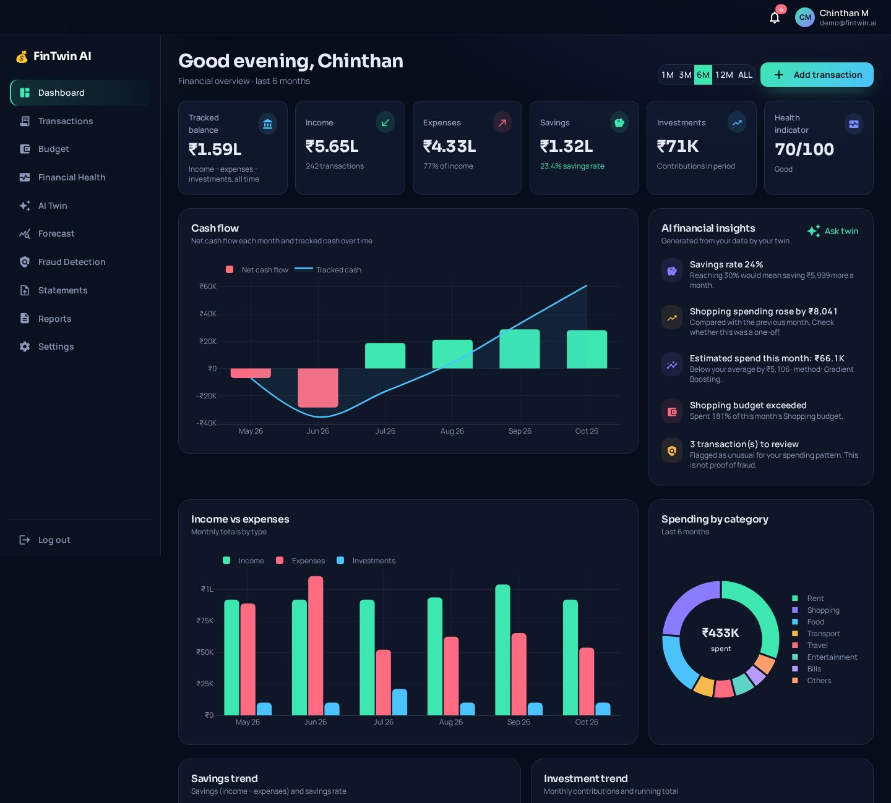
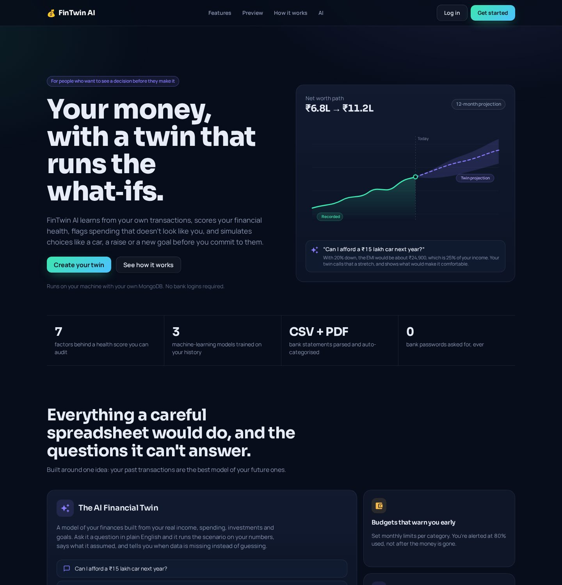
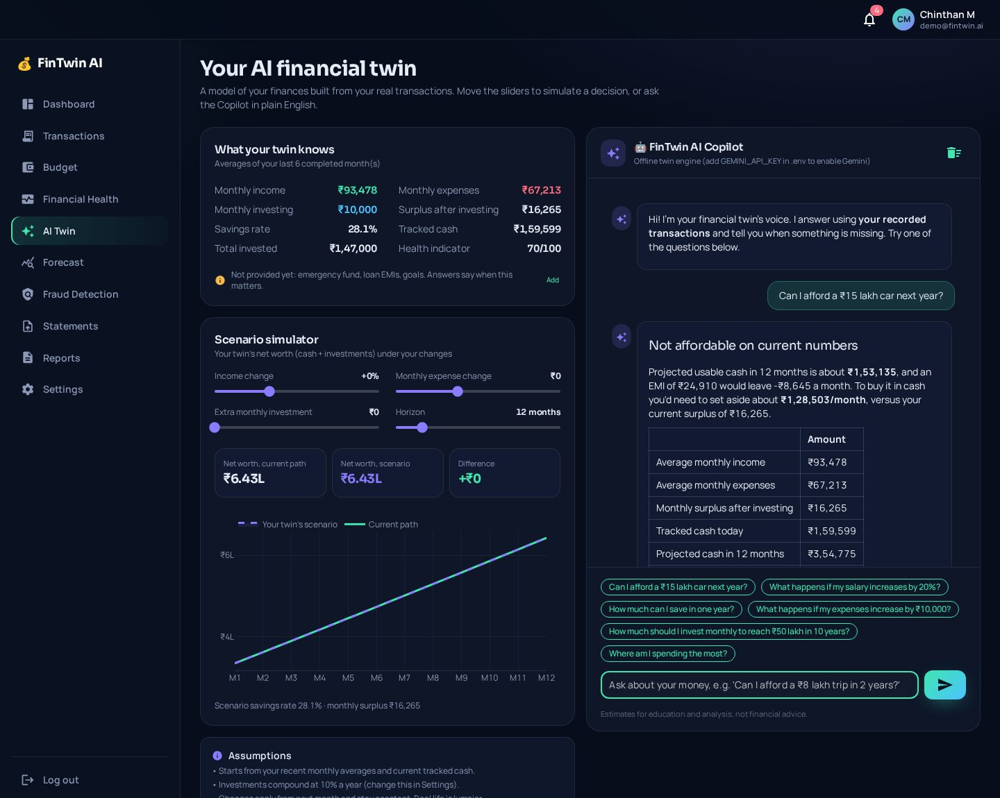
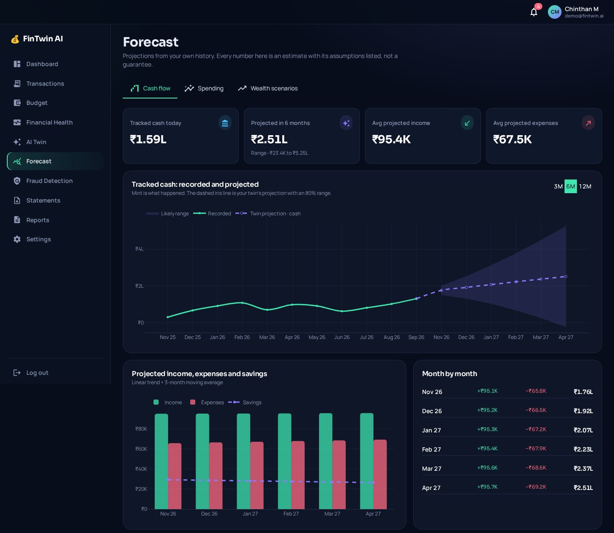
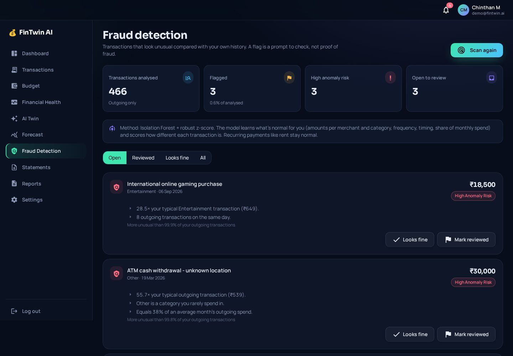
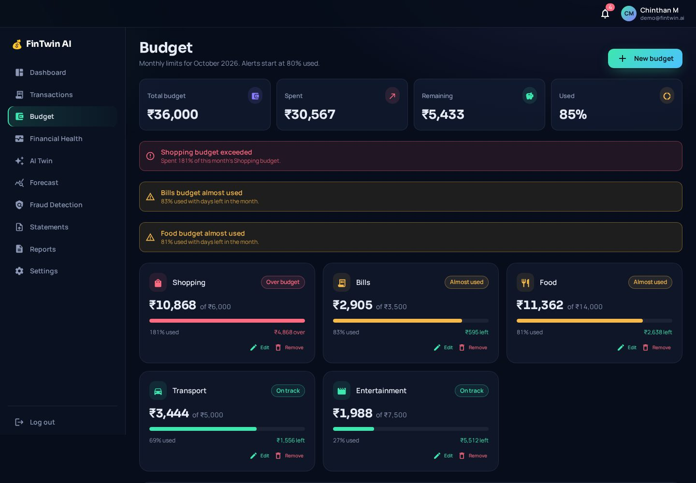
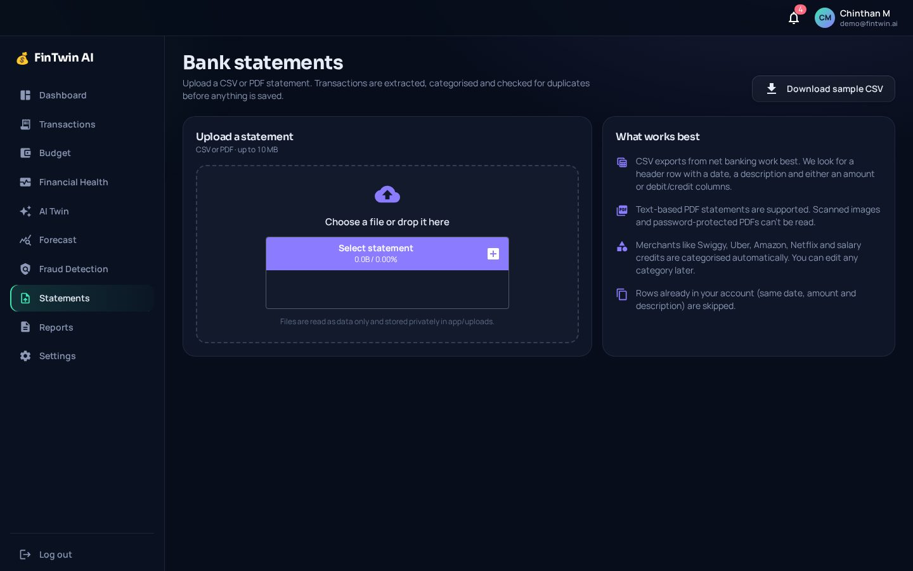

# 💰 FinTwin AI

**An AI-powered personal financial twin and finance management platform**, built end to end in Python with NiceGUI, MongoDB, Pandas, Plotly and scikit-learn.

FinTwin AI turns a person's transactions into a *financial twin*: a data-driven model of their finances that can answer what-if questions ("Can I afford a ₹15 lakh car next year?"), score financial health transparently, flag spending that doesn't look like them, and forecast cash flow and wealth, always with stated assumptions.



> FinTwin AI is an educational / analytical software project. Scores, forecasts and anomaly flags are estimates, not financial advice or proof of fraud.

---

## Contents

- [Features](#features)
- [Screenshots](#screenshots)
- [Tech stack](#tech-stack)
- [Architecture](#architecture)
- [Quick start (Windows + PowerShell)](#quick-start-windows--powershell)
- [MongoDB setup](#mongodb-setup)
- [Running the app](#running-the-app)
- [AI and machine learning](#ai-and-machine-learning)
- [Database design](#database-design)
- [Testing](#testing)
- [Project structure](#project-structure)
- [Security](#security)
- [Future improvements](#future-improvements)

---

## Features

| Area | What it does |
|---|---|
| **Landing page** | Dark, glass-styled marketing page with hero, product facts, bento feature grid, a live dashboard preview computed from demo data, how-it-works, AI section, CTA and footer. |
| **Authentication** | Register / login / logout, bcrypt password hashing, signed server-side sessions, protected routes, login rate limiting, safe redirects. |
| **Dashboard** | KPI tiles (tracked balance, income, expenses, savings & rate, investments, health), cash-flow chart, income vs expenses, spending donut, savings trend, investment trend, recent transactions, budgets, AI insights. Period filter (1M / 3M / 6M / 12M / all). |
| **Transactions** | Full CRUD, search, filter by type / category / date range, sort, pagination, CSV export, smart category suggestions while typing. |
| **Budgets** | Monthly limits per category, spent / remaining / % used, alerts at 80 % and 100 %, suggested budgets from your own averages, unbudgeted spending. |
| **Financial health** | Transparent 0–100 indicator from 7 weighted factors, each with its rule, value, sub-score and tip. Rounded to the nearest 5 to avoid false precision; estimated inputs are labelled. |
| **Forecast** | Cash-flow projection with 80 % range, spending estimate for the current month with model evaluation, wealth scenario calculator (3 return assumptions, step-up, inflation). |
| **Fraud detection** | Per-user Isolation Forest + robust z-scores; labels *Normal / Potentially Unusual / High Anomaly Risk*, plain-language reasons, review workflow (looks fine / reviewed / reopen). |
| **AI Twin** | Live scenario simulator (income change, expense change, extra investing, horizon) and the **FinTwin AI Copilot** chat. Works fully offline; optionally uses Gemini. |
| **Bank statements** | CSV and text-PDF upload → validation → parsing → normalization → auto-categorization → duplicate detection → review → import. |
| **Reports** | Summary, monthly breakdown, top categories, budget performance, health factors, anomalies, forecast and recommendations. Export as printable HTML (save as PDF) or CSV. |
| **Settings** | Emergency fund, loan EMIs, expected return, risk profile, goals, name, password, demo data, uploaded files, account deletion. |

## Screenshots

| Landing | AI Twin + Copilot |
|---|---|
|  |  |

| Forecast | Fraud detection |
|---|---|
|  |  |

| Budget | Bank statements |
|---|---|
|  |  |

## Tech stack

| Layer | Technology |
|---|---|
| Language | Python 3.11.9 |
| UI / web | NiceGUI 3 (FastAPI + Vue/Quasar under the hood), Tailwind utility classes |
| Database | MongoDB via PyMongo (mongomock for demo mode and tests) |
| Data | Pandas, NumPy |
| Charts | Plotly |
| ML | scikit-learn (Gradient Boosting, Random Forest, Isolation Forest, Linear Regression), joblib |
| Auth | bcrypt, NiceGUI signed user storage |
| Config | python-dotenv |
| PDF parsing | pdfplumber |
| LLM (optional) | Google Gemini REST API, isolated in `app/ai/llm_provider.py` |
| Tests | pytest (103 tests) |

## Architecture

```text
User
 │
 ▼
NiceGUI pages (app/pages)          ← routes, layout, protected pages
 │
 ▼
Components (app/components)        ← reusable UI: shell, sidebar, charts, tables, chat
 │
 ▼
Services (app/services)            ← business logic, validation, orchestration
 │
 ├──────────────────────┐
 ▼                      ▼
Database (app/database) AI / ML (app/ai)
 │                      │
 ▼                      ▼
MongoDB                 Predictions, anomalies, forecasts, twin answers
```

End-to-end data pipeline:

```text
Transactions (manual · CSV/PDF statements · demo data)
  → MongoDB (per-user documents)
  → Pandas DataFrame (typed, monthly aggregation)
  → Analytics (summary, categories, trends, budgets, health score)
  → ML models (spending prediction · anomaly detection · cash-flow forecast)
  → AI Financial Twin (scenario engine on the user's real numbers)
  → Copilot (optional LLM, constrained to the twin's numbers)
  → Personalized insights, reports and alerts
```

More detail: [docs/architecture.md](docs/architecture.md).

## Quick start (Windows + PowerShell)

Full beginner walkthrough: [docs/setup.md](docs/setup.md).

```powershell
D:
Set-Location D:\FinTwin_AI
py -3.11 -m venv venv
.\venv\Scripts\Activate.ps1
python -m pip install --upgrade pip
pip install -r requirements.txt
Copy-Item .env.example .env
```

Then edit `.env`:

- set `STORAGE_SECRET` to a long random value (see `docs/setup.md` for a one-line generator), and
- choose a database: keep `MONGO_URI=mongodb://localhost:27017` if MongoDB is installed, **or** use `MONGO_URI=mongomock://localhost` to try the app instantly without MongoDB (in-memory; data is lost when the app stops).

## MongoDB setup

1. Download **MongoDB Community Server** (MSI) for Windows from mongodb.com and install it with "Install MongoDB as a Service" ticked.
2. Optionally install **MongoDB Compass** to browse data.
3. Check the service:

```powershell
Get-Service MongoDB
net start MongoDB
```

The app creates the `fintwin_ai` database, all eight collections and their indexes on first connection.

## Running the app

```powershell
Set-Location D:\FinTwin_AI
.\venv\Scripts\Activate.ps1
python -m app.main
```

Open http://127.0.0.1:8080, create an account, and click **Load demo data** to explore 12 months of fictional transactions immediately.

Optional:

```powershell
python -m app.ai.train_models   # regenerate datasets/ and retrain the spending model
pytest                          # run the test suite
```

## AI and machine learning

Every model reports how it was evaluated and what it assumed. Full write-up: [docs/ai_models.md](docs/ai_models.md).

| Feature | Module | Approach |
|---|---|---|
| Spending prediction | `app/ai/spending_predictor.py` | Scale-free monthly features (lags ÷ recent average, 6-month mean/median, income, frequency, trend, volatility, seasonality). Random Forest and Gradient Boosting (absolute-error loss) compete against two baselines on held-out months; a model is used **only if it beats both baselines**. Trained on a synthetic 80-user population, saved with joblib. Current hold-out MAE: Gradient Boosting ±13.8 % vs 3-month average ±15.9 %. |
| Anomaly detection | `app/ai/fraud_detector.py` | Per-user Isolation Forest on amount, robust z-score (merchant → category → overall baseline), category rarity, day-of-week, day-of-month, same-day count, days since same category, share of monthly spend. Labels plus human-readable reasons; recurring payments stay normal. |
| Cash-flow forecast | `app/ai/cashflow_forecast.py` | Linear trend blended 50/50 with a 3-month moving average (moving average only below 6 months), spikes winsorized, ~80 % band widening with horizon. |
| Wealth projection | `app/ai/wealth_forecast.py` | Monthly compounding, optional yearly step-up, inflation-adjusted value, ±3 % return scenarios, surplus check. |
| Financial Twin | `app/ai/financial_twin.py` | Builds a state from real averages and profile facts; simulates affordability (cash vs loan/EMI), income and expense changes, savings, goal-based investing, spending breakdown, health and emergency fund. Parses ₹ amounts (lakh, crore, k), percentages and durations. Lists missing data and assumptions; never invents numbers. |
| Copilot | `app/ai/copilot.py`, `app/ai/llm_provider.py` | Chat UI → twin analysis → financial context → optional Gemini rewrite with strict rules → response. Falls back to the offline twin answer if no key or on error. |
| Categorization | `app/ai/categorizer.py` | Ordered keyword/regex rules for Indian merchants (Swiggy, Uber, Amazon, Netflix, salary credits, SIPs…) with confidence; drop-in replaceable by an ML classifier. |

## Database design

Database `fintwin_ai`, collections: `users`, `transactions`, `budgets`, `financial_profiles`, `predictions`, `fraud_alerts`, `ai_conversations`, `reports`. Every financial document carries `user_id`, and every query filters by it. Schemas and indexes: [docs/database.md](docs/database.md).

## Testing

```powershell
pytest
```

103 tests cover authentication, transaction calculations and validation, user data isolation, budgets, the health score, fraud detection, forecasts and wealth maths, the financial twin and categorizer, statement parsing and reports. Tests run against an in-memory MongoDB, so no database is needed.

## Project structure

```text
FinTwin_AI/
├── app/
│   ├── ai/            spending_predictor, fraud_detector, cashflow_forecast, wealth_forecast,
│   │                  financial_twin, copilot, llm_provider, categorizer, train_models
│   ├── assets/fonts/  self-hosted Sora + Manrope (SIL OFL)
│   ├── auth/          security (bcrypt), session (protected routes)
│   ├── components/    app_shell, sidebar, navbar, hero, stats, feature_grid, dashboard_preview,
│   │                  landing_sections, dashboard_cards, charts, transaction_table,
│   │                  transaction_form, ai_copilot, notification_panel, onboarding
│   ├── database/      mongodb, user/transaction/budget/insight repositories
│   ├── models/        transaction, user, budget, financial_profile
│   ├── pages/         landing, auth, dashboard, transactions, budget, financial_health,
│   │                  forecast, fraud, ai_twin, upload, reports, settings_page
│   ├── services/      auth, transaction, analytics, budget, health, fraud, insight,
│   │                  statement, report, demo_data
│   ├── styles/        theme (design tokens, CSS, Plotly layout)
│   ├── uploads/       user statement files (git-ignored)
│   ├── utils/         config helpers, errors, formatters, validators, dates, logger
│   ├── config.py
│   └── main.py
├── datasets/          synthetic training data and a sample bank statement
├── docs/              architecture, database, AI models, setup, API, screenshots
├── tests/             pytest suite
├── trained_models/    joblib models (git-ignored)
├── .env.example  .gitignore  pytest.ini  requirements.txt  README.md
```

## Security

- Passwords hashed with bcrypt (salted, 12 rounds); 72-byte limit enforced; generic login errors; 5-attempt lockout.
- Sessions are server-side and identified by a cookie signed with `STORAGE_SECRET`; 7-day expiry; open-redirect protection.
- All user data queries are scoped by `user_id`; ownership is checked on update and delete.
- Input validation on every write (amounts, dates, categories, text sanitising, escaped regex search).
- Uploads: extension + content checks, size cap, generated file names, parsed as data only, never executed.
- Secrets live only in `.env` (git-ignored); the Gemini key is sent only as a request header and never logged.
- Friendly error pages in the UI; technical details go to `logs/fintwin.log`.
- HTML report output escapes all user-provided text.

## Future improvements

- ML-based transaction categorization trained on user corrections.
- Account aggregation via India's Account Aggregator framework (with consent).
- Recurring transaction detection and bill reminders.
- Multi-currency support and net-worth tracking for assets and liabilities.
- Background jobs for scheduled anomaly scans and monthly email reports.
- OCR for scanned statements.
- Deployment guide (reverse proxy, HTTPS, MongoDB Atlas).

## Interview summary

> FinTwin AI is a Python-based personal finance SaaS application that collects and analyzes user financial transactions using MongoDB and Pandas. The application calculates financial metrics, performs anomaly detection and predictive analytics using machine-learning models, and combines those insights with an AI Financial Twin to simulate financial scenarios and provide personalized financial insights.
